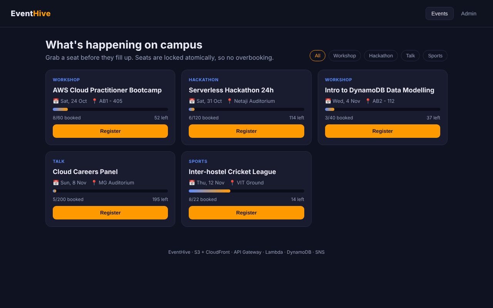
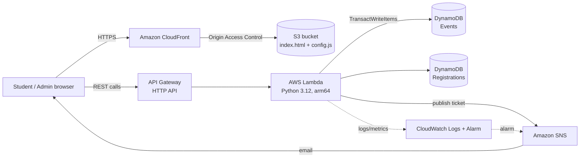
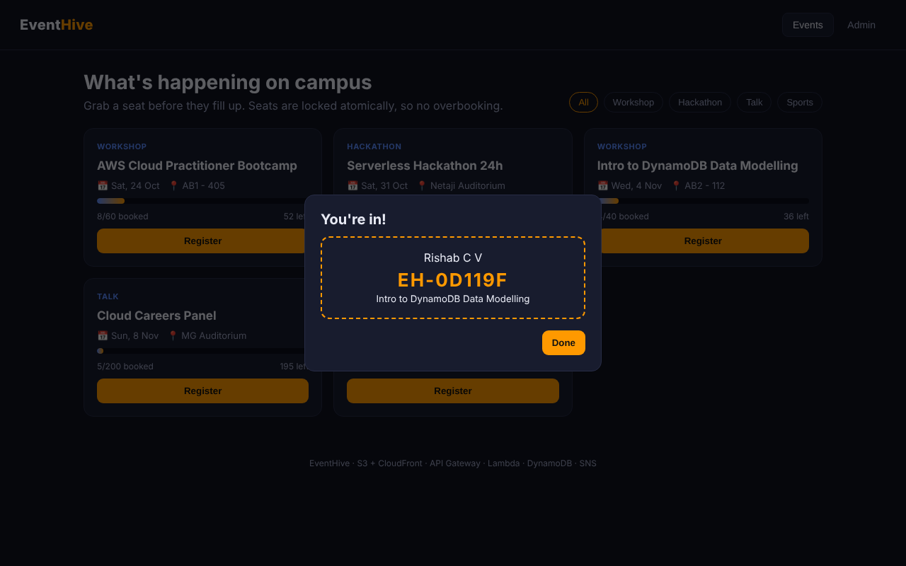
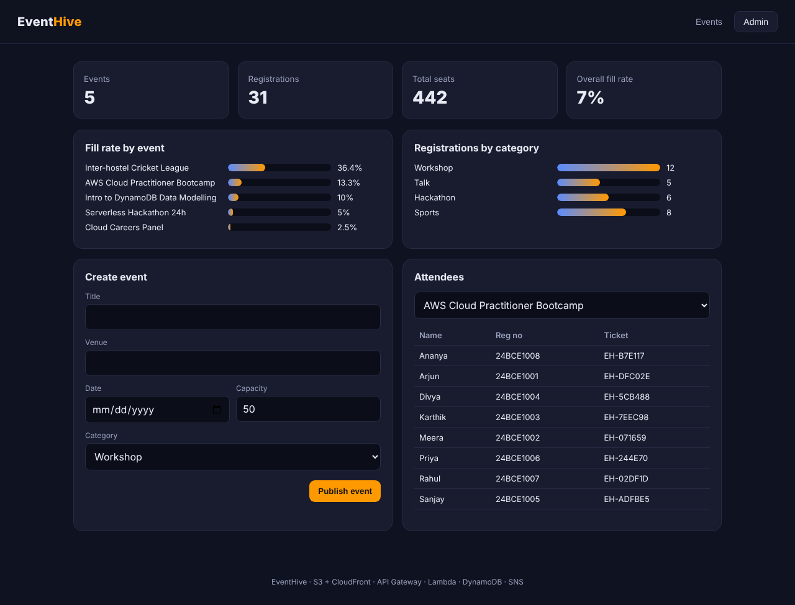

# EventHive – Serverless Campus Event Registration on AWS

EventHive is a fully serverless web app that lets students browse campus events, book a seat and get a ticket instantly, while organisers get a live analytics dashboard. It is built only from managed AWS services, so there are no servers to patch and the whole stack costs close to nothing when idle.

> Digital Assignment 3 – AWS Cloud project · Rishab C V (24BCE5296), VIT Chennai



## Architecture



| Layer | Service | Why |
|---|---|---|
| Frontend hosting | S3 (private) + CloudFront with OAC | HTTPS, global caching, bucket never public |
| API | API Gateway HTTP API | Cheaper and faster than REST API, built-in CORS and throttling |
| Compute | Lambda (Graviton arm64, 128 MB) | Pay per request, ~20% cheaper than x86 |
| Database | DynamoDB on-demand (2 tables) | Single-digit ms reads, zero cost when idle |
| Notifications | SNS | Ticket confirmation emails + alarm alerts |
| Monitoring | CloudWatch Logs (7-day retention) + Errors alarm | Observability without log-storage creep |
| IaC | AWS SAM / CloudFormation | Whole stack created or deleted with one command |

## Key engineering points

- **No overbooking, even under concurrency.** Registering is a single DynamoDB `TransactWriteItems` call: it increments the seat count only if `registered < capacity` *and* inserts the registration only if that email isn't already booked. Both succeed or neither does. `test_no_overbooking_under_load` fires 20 parallel registrations at a 2-seat event and checks exactly 2 succeed.
- **Duplicate protection.** Registrations table uses `(eventId, email)` as the key, so the same student can't book twice.
- **Least-privilege IAM.** The Lambda role only gets CRUD on its two tables and publish on its one topic (SAM policy templates).
- **Private S3.** All public access is blocked; only CloudFront can read the bucket through Origin Access Control.
- **API throttling.** 10 req/s steady, 20 burst – protects the account from abuse and surprise bills.
- **Admin endpoints** (create/delete events, attendee list, stats) need an `x-admin-key` header passed in as a NoEcho CloudFormation parameter.

## API

| Method | Path | Auth | Description |
|---|---|---|---|
| GET | `/events` | – | List events sorted by date |
| POST | `/events` | admin | Create an event |
| DELETE | `/events/{id}` | admin | Delete an event and its registrations |
| POST | `/events/{id}/register` | – | Book a seat, returns ticket ID |
| GET | `/events/{id}/registrations` | admin | Attendee list |
| GET | `/stats` | admin | Totals, fill rate per event and per category |

## Run it locally (zero AWS cost)

The local server uses [moto](https://github.com/getmoto/moto) to emulate DynamoDB and SNS in memory, so the **same `app.py` Lambda code** runs on your laptop without an AWS account.

```bash
pip install -r requirements.txt
python local_server.py
```

Open http://localhost:8080. Admin key: `vit-admin`.

Run the tests:

```bash
python test_app.py
```

## Deploy to AWS

Needs the AWS CLI and SAM CLI configured.

```bash
export ADMIN_KEY=choose-a-strong-key
export NOTIFY_EMAIL=you@example.com
./deploy.sh
```

The script prints the CloudFront site URL and API URL. When you're done:

```bash
./deploy.sh destroy
```

## Cost estimate (ap-south-1)

| Service | Demo / class usage | Cost |
|---|---|---|
| Lambda | < 10k requests | Free tier (1M/month) |
| API Gateway HTTP API | < 10k requests | ~$0.01 |
| DynamoDB on-demand | < 1 MB data, < 10k ops | Free tier (25 GB) |
| S3 | 2 files, < 50 KB | ~$0.00 |
| CloudFront | < 1 GB transfer | Free tier (1 TB/month) |
| SNS email | < 100 emails | Free tier (1k/month) |
| **Total** | | **≈ $0 – $0.05 / month** |

Nothing runs 24/7, so unlike an EC2-based design there is no hourly charge, no public IPv4 charge and no idle cost.

## Screenshots

| Ticket | Admin dashboard |
|---|---|
|  |  |

## Files

| File | Purpose |
|---|---|
| `app.py` | Lambda handler and all API logic |
| `index.html`, `config.js` | Frontend (static, served from S3/CloudFront) |
| `template.yaml` | SAM / CloudFormation template for the full stack |
| `deploy.sh` | Build, deploy, upload frontend, or destroy |
| `local_server.py` | Local runner using moto |
| `test_app.py` | Unit + concurrency tests |
| `EventHive_Project_Report.pdf` | DA3 project report |

## Future work

- Replace the admin key with Amazon Cognito user pools
- QR code tickets and check-in scanning at the venue
- DynamoDB Streams → Lambda for waitlist auto-promotion
- AWS WAF in front of CloudFront
